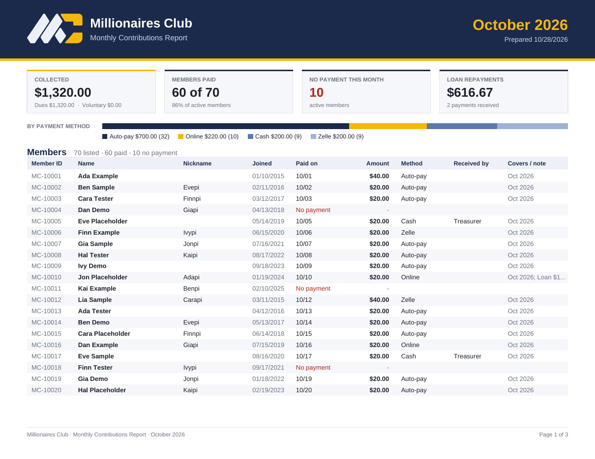

# Monthly report

The monthly contributions report replaces the month sheet the club kept by hand. It lists every member with what they paid in the month, adds it all up, and lists the loan repayments that came in. It downloads as a **PDF**, to print or share, or as a **CSV**, to open in a spreadsheet.

**Where to find it:** **Contributions → Monthly report.** Pick the month, then **Download PDF** or **CSV**. The page shows the same figures as the files. Anyone who can see contributions (permission `contributions.read`) can download it.

## What's in it

**Header:** the club's logo and name, the month, and the date the report was prepared.

**Summary tiles:**
- **Collected:** what members paid in the month, split into dues and voluntary contributions.
- **Members paid:** how many active members paid, out of how many, and the percentage.
- **No payment this month:** the active members who didn't pay, shown in red if there are any.
- **Loan repayments:** what came in on loans, and how many repayments.

**By payment method:** a bar and legend with each method's total and number of payments (Auto-pay, Online, Cash, Zelle…). Payments recorded without a method show as "Not given".

**Members:** one row per member, in member-number order. Columns:
- Member ID, name, nickname and join date;
- **Paid on:** the date(s) paid, or **No payment** in red;
- **Amount:** a member who paid twice shows both dates and the total;
- **Method** and **Received by**;
- **Covers / note:** what the receipt covered (e.g. "Oct 2026"), and any note.

A total row closes the table. Long tables continue on the next pages, with the column titles repeated.

**Loan repayments received:** each repayment's loan, borrower, date, amount, method and who received it, with a total.

**Sign-off:** lines for the Treasurer, who prepares it, and a reviewer to sign and date. Every page has a footer with the report's name and "Page X of Y".

The **CSV** has one row per member with the same columns, plus their status and receipt numbers.

## How it counts

- **Month:** a payment belongs to the month it was received, by its payment date in the club's time zone. So the report adds up to the money that came in that month, whichever month the payment covers (the Covers column says that).
- **Reversed contributions** are left out.
- **Members listed:** every active member, and anyone else who paid that month (for example, a member who has since left).
- **Loan repayments:** those received in the month. The sum brought forward from the 2021–2025 records has no real date and is left out.
- **Which months:** this month and any earlier one. A future month is refused.
